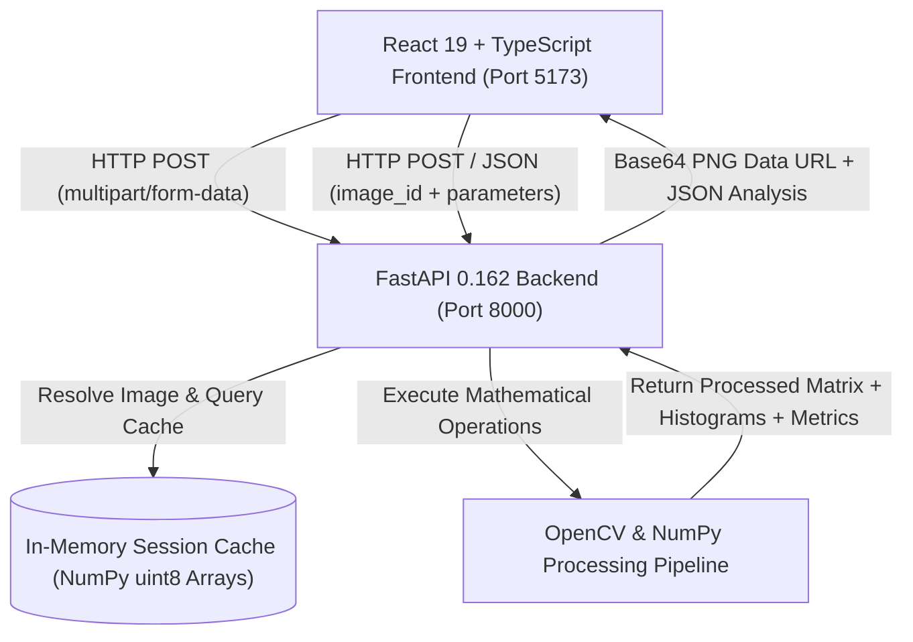

# ImageRevive — An Intelligent Image Enhancement & Analysis Studio

[](https://www.python.org/)
[](https://fastapi.tiangolo.com/)
[](https://react.dev/)
[](https://www.typescriptlang.org/)
[](https://opencv.org/)
[](https://tailwindcss.com/)

**ImageRevive** is an intelligent image enhancement and analysis studio designed for photographers, designers, content creators, researchers, and developers. Built on a local high-performance computational pipeline with FastAPI, NumPy, and OpenCV, it provides deep pixel-level exploration, spatial and frequency filtering, contrast refinement, noise restoration, and quantitative side-by-side analytics.

---

## Table of Contents

1. [Academic Problem Statement & Objectives](#1-academic-problem-statement--objectives)
2. [Syllabus Alignment Matrix (Modules 1–6)](#2-syllabus-alignment-matrix)
3. [System Architecture](#3-system-architecture)
4. [Technology Stack](#4-technology-stack)
5. [Visual Design: Darkroom Studio](#5-visual-design-darkroom-studio)
6. [Workspaces & Features](#6-workspaces--features)
7. [Mathematical Foundations & Algorithm Theory](#7-mathematical-foundations--algorithm-theory)
8. [University Viva Voce Preparation Guide](#8-university-viva-voce-preparation-guide)
9. [Project Directory Structure](#9-project-directory-structure)
10. [Installation & Local Startup](#10-installation--local-startup)
11. [REST API Documentation](#11-rest-api-documentation)
12. [Testing & Quality Assurance](#12-testing--quality-assurance)
13. [Limitations & Future Roadmap](#13-limitations--future-roadmap)

---

## 1. Academic Problem Statement & Objectives

In university Digital Image Processing courses, students frequently study mathematical transformations—such as spatial convolution, histogram equalization, Fourier phase spectra, and non-linear order-statistics restoration—without the ability to inspect raw matrix calculations interactively.

**ImageRevive** eliminates abstract guesswork by providing an interactive studio where:
- Every operation operates on **authentic pixel arrays** via NumPy and OpenCV (no simulated mock filters).
- Pixel coordinates and neighborhood matrices can be inspected down to the individual pixel level.
- Mathematical equations and physical intuitions are embedded directly alongside interactive controls.
- Degraded images are quantitatively evaluated against clean ground truth using **MSE**, **PSNR**, **SSIM**, and **MAE**.
- Before-and-after dynamic range distributions are rendered with live 256-bin histograms.

---

## 2. Syllabus Alignment Matrix

| Syllabus Module | Theoretical Concepts Covered | ImageRevive Implementation | Workspace |
| :--- | :--- | :--- | :--- |
| **Module 1: Introduction** | Pixels, coordinate conventions, RGB channels, spatial sampling rate, Nyquist limit, intensity quantization. | Interactive pixel coordinate loupe ($5\times 5$ neighborhood), channel stats, adjustable spatial downsampling ($2\times$ to $32\times$), and bit-depth quantization ($1$ to $7$ bits with false contouring). | **Image Inspector** |
| **Module 2: Spatial Domain Filtering** | Point transformations, contrast stretching, histogram equalization, correlation vs convolution, smoothing, sharpening, Sobel gradient, Laplacian. | Brightness offset, linear contrast scale, min-max stretching, power-law gamma ($\gamma$), color-preserving YCrCb equalization, $3\times 3$ and $5\times 5$ custom matrix convolution, $180^\circ$ rotation toggle, boundary padding modes, unsharp masking, Sobel $G_x/G_y$, and raw/sharpened Laplacian. | **Enhancement Lab** & **Filtering Playground** |
| **Module 3: Frequency Domain Filtering** | 2D Fast Fourier Transform (FFT), magnitude and phase spectra, ideal vs Gaussian lowpass/highpass filtering. | Centered 2D FFT computation, log-magnitude spectrum visualizer, phase angle spectrum, and Gaussian/Ideal/Butterworth frequency filters. | **Filtering Playground** |
| **Module 4: Image Restoration** | Degradation framework ($g = f*h + \eta$), additive Gaussian noise, bipolar impulse (salt & pepper) noise, speckle noise, median filter, linear mean filter. | Parametric noise simulator, non-linear median filter, arithmetic mean, bilateral filter, and automated MSE/PSNR/SSIM calculation against clean ground truth. | **Restoration Lab** |
| **Module 5: Image Compression** | Information entropy, lossy vs lossless principles, dynamic range truncation. | Real-time Shannon information entropy ($H = -\sum p \log_2 p$) in bits/pixel, bit-depth quantization. | **Image Inspector** |
| **Module 6: Image Segmentation** | First-order edge detection, gradient magnitude, binarization thresholding, second-derivative zero-crossings. | Directional Sobel, Prewitt, and Scharr operators, gradient magnitude thresholding, and Laplacian zero-crossing visualization. | **Filtering Playground** |

---

## 3. System Architecture



### Architectural Highlights
- **In-Memory Session Cache**: Processing operations store active matrices in memory and assign unique UUIDs. Successive filter tweaks pass lightweight `image_id` strings without re-uploading large image payloads.
- **Client-Side Theme Engine**: Synchronized with operating system color schemes (`(prefers-color-scheme: dark)`), persisted in `localStorage`, and executed without rendering flash.
- **Locomotive Scroll Integration**: Controlled Lenis-based smooth scrolling configured to avoid conflicts with range sliders, drag handles, and canvas coordinates.

---

## 4. Technology Stack

### Frontend
- **React 19.3**: Modern functional component architecture with hooks and concurrent features.
- **Vite 8.3**: Ultra-fast bundler with Hot Module Replacement (HMR).
- **TypeScript 6.0**: Strict static typing with type-only import enforcement (`verbatimModuleSyntax`).
- **Tailwind CSS v4.3**: Custom Darkroom Studio design tokens and CSS variables.
- **React Router 7.1**: Declarative client-side routing.
- **Lucide React**: Clean, semantic vector iconography.
- **Recharts 3.10**: Hardware-accelerated 256-bin RGB and Luminance distribution histograms.
- **Locomotive Scroll 5.0**: Smooth scrolling wrapper with reduced-motion support.

### Backend
- **Python 3.13**: Modern Python runtime.
- **FastAPI 0.162**: Asynchronous, high-performance web framework with OpenAPI / Swagger documentation.
- **OpenCV 5.0 (`opencv-python`)**: Industrial-strength computer vision algorithms and kernel operations.
- **NumPy 2.5**: Optimized multi-dimensional matrix operations.
- **Pillow 13.0**: Robust image I/O and format validation.
- **Uvicorn 0.54**: ASGI web server.

---

## 5. Visual Design: Darkroom Studio

The application uses an authentic darkroom photo-editing interface inspired by professional creative workstations:

| Token | Dark Palette (Default) | Light Palette | Semantic Purpose |
| :--- | :--- | :--- | :--- |
| **Main Background** | `#17191C` | `#F5F3EE` | Canvas workspace backdrop |
| **Sidebar** | `#202328` | `#ECE9E2` | Primary navigation drawer |
| **Surface** | `#272B30` | `#FFFFFF` | Cards, control panels, containers |
| **Elevated** | `#2D3238` | `#FAF8F4` | Hover states, inputs, sub-panels |
| **Primary Text** | `#F2F0EB` | `#24262A` | Headings, active values, labels |
| **Secondary Text** | `#A3A7AE` | `#62666D` | Subtitles, descriptions |
| **Muted Text** | `#7E858E` | `#858A91` | Units, coordinates, timestamps |
| **Border** | `#383D44` | `#DFDCD4` | Standard structural dividers |
| **Strong Border** | `#4A515A` | `#C9C5BC` | Focused elements, active tabs |
| **Accent** | `#E5A34D` | `#A96618` | Warm amber focus, sliders, highlights |
| **Accent Hover** | `#F0B564` | `#8E5312` | Interactive button hover |
| **Success** | `#83B692` | `#39764D` | Status online, high SSIM badge |
| **Error** | `#D97777` | `#B54747` | Validation alerts, offline warning |

### Typography
- **Headings**: `Manrope` (Geometric, clean, modern).
- **Body & Controls**: `Inter` (Optimized for interface readability).
- **Technical & Numeric**: `JetBrains Mono` (Monospaced coordinates, pixel values, matrix coefficients, and LaTeX formulas).

---

## 6. Workspaces & Features

### 1. Overview & Studio Central (`/`)
- Drag-and-drop file upload zone supporting **JPEG**, **PNG**, and **WebP** up to 15 MB.
- Client- and server-side file format and dimension validation (max 4096×4096 px).
- 4 preloaded procedural academic benchmark images:
  1. *Cameraman Silhouette & Resolution Target* (Edge & fine detail).
  2. *Siemens Star & Frequency Target* (High-frequency spokes for aliasing and FFT testing).
  3. *Low-Contrast Radiographic Phantom* (Narrow dynamic range for contrast stretching).
  4. *Chromatic Color Studio* (Multi-channel RGB gradients for color-preserving operations).
- Engine status indicator with live health polling.

### 2. Image Inspector & Sampling Lab (`/inspector`)
- **Central Coordinate Inspector**: Interactive crosshair tracking mouse hover and clicks.
- **Pixel Loupe**: Displays exact $(X, Y)$ coordinate (origin top-left), raw RGB tuple, Hex code, normalized float $[0, 1]$, and an interactive $5\times 5$ neighborhood grid with individual intensity values.
- **Spatial Sampling Lab**: Experiment with downsampling factors ($2\times$ to $32\times$) with nearest-neighbor reconstruction to demonstrate spatial aliasing and pixelation.
- **Intensity Quantization Lab**: Experiment with bit-depth reductions ($1$ to $7$ bits; $2$ to $128$ gray levels) to demonstrate false contouring.
- **Global Distribution**: 256-bin RGB and Luminance histogram with Shannon information entropy calculation.

### 3. Spatial Enhancement Lab (`/enhancement`)
- **Contrast Stretching (Min-Max Normalization)**: Auto 1% percentile tail clipping or manual lower/upper bounds $[r_{min}, r_{max}] \rightarrow [0, 255]$.
- **Histogram Equalization**:
  - *Color-Preserving*: Transforms RGB to YCrCb, equalizes luminance $Y$ only, preserving natural chromaticity.
  - *Grayscale*: Computes cumulative distribution function (CDF) across $[0, 255]$.
- **Power-Law (Gamma) Correction**: $s = c \cdot r^\gamma$ with precomputed lookup tables (LUT).
- **Brightness & Linear Contrast**: Additive shift $f(x, y) + \Delta b$ and gain/bias $\alpha f(x, y) + \beta$.
- **Grayscale Models**: Perceptual Luminance (ITU-R BT.601) vs Arithmetic Average.
- **Dual Histogram Comparison**: Live before-and-after histogram rendering.

### 4. Spatial Filtering Playground (`/filtering`)
- **Interactive Kernel Explorer**:
  - Editable $3\times 3$ matrix coefficient grid with direct numeric input.
  - Preloaded kernels: Identity, Box Blur, Gaussian, Sharpen, Emboss, Sobel X, Sobel Y, Laplacian.
  - **Convolution vs Correlation Toggle**: Rigorously flips kernel $180^\circ$ for convolution.
  - **Boundary Padding**: Replicate (clamp), Reflect (mirror), and Constant (zero-padding).
  - Normalization toggle (divides matrix by sum of coefficients).
- **Smoothing Filters**: Gaussian ($\sigma$ and odd kernel size) and Box Mean smoothing.
- **Sharpening Filters**: Unsharp masking ($f + k \cdot g_{mask}$) and Laplacian sharpening.
- **Gradient Operators**: First-order Sobel, Prewitt, and Scharr operators with horizontal ($G_x$), vertical ($G_y$), and magnitude ($\sqrt{G_x^2 + G_y^2}$) outputs with optional binarization threshold.
- **Laplacian Operators**: $4$-neighbor and $8$-neighbor isotropic second derivatives; raw response (centered at baseline 128) vs composite sharpened image.
- **2D Fourier Domain Lab (Module 3)**: Computes 2D FFT, rendering centered log-magnitude spectrum $S(u, v) = \log(1 + |F(u, v)|)$ and phase spectrum $\theta(u, v)$. Applies Gaussian and Ideal frequency-domain filters.

### 5. Image Degradation & Restoration Lab (`/restoration`)
- **Step 1: Noise Degradation Simulation**:
  - *Gaussian Noise*: Additive thermal sensor noise $\eta \sim \mathcal{N}(\mu, \sigma^2)$.
  - *Salt & Pepper Noise*: Bipolar impulse noise replacing random pixels with 0 or 255.
  - *Speckle Noise*: Multiplicative scattering noise $g = f + f \cdot n$.
- **Step 2: Restoration Filters**:
  - *Median Filter*: Non-linear order-statistics filter that completely suppresses impulse noise without blurring step edges.
  - *Arithmetic Mean Filter*: Optimal for Gaussian noise, but smears impulse spikes.
  - *Gaussian Filter*: Frequency-selective spatial lowpass.
  - *Bilateral Filter*: Edge-preserving smoothing combining photometric and geometric distances.
- **Quantitative Performance Evaluation**:
  - Real-time Mean Squared Error (**MSE**).
  - Peak Signal-to-Noise Ratio (**PSNR** in dB).
  - Structural Similarity Index (**SSIM**).
  - Mean Absolute Error (**MAE**).

### 6. Algorithm Arena (`/arena`)
- Two-way benchmark bench comparing any two algorithms on the same input image.
- Side-by-side or split comparison slider between Contender A and Contender B.
- Dual PSNR, SSIM, and MSE metrics computed against ground truth.
- Dual histogram comparison.

### 7. Session Processing History (`/history`)
- Real-time audit trail of all operations executed in the active session.
- Records operation name, timestamp, parameter snapshot, and objective metrics.
- One-click **Download Export** or **Load to Workspace** to chain multi-stage operations.
- Lightweight metadata stored in `sessionStorage`; image blobs retained in server memory.

### 8. About DIP Handbook (`/about`)
- Comprehensive syllabus guide across Modules 1 to 6.
- Mathematical formulations, physical intuitions, typical use cases, and limitations.
- Viva Voce Interview Preparation Guide with common university viva questions and answers.

---

## 7. Mathematical Foundations & Algorithm Theory

### Contrast Stretching (Min-Max Normalization)
$$s = T(r) = \left(\frac{r - r_{min}}{r_{max} - r_{min}}\right) \times (L - 1)$$
Expands a compressed intensity histogram to occupy the full 8-bit dynamic range $[0, 255]$. To prevent single-pixel outliers from dominating the range, ImageRevive clips the bottom 1% and top 1% percentiles:
$$r_{min} = P_{1\%}, \quad r_{max} = P_{99\%}$$

### Histogram Equalization
$$s_k = T(r_k) = (L - 1) \sum_{j=0}^{k} p_r(r_j) = \frac{(L - 1)}{MN} \sum_{j=0}^{k} n_j$$
Where $p_r(r_j)$ is the probability of intensity level $r_j$. In color mode, RGB is transformed to YCrCb:
$$Y = 0.299R + 0.587G + 0.114B, \quad C_b = -0.169R - 0.331G + 0.500B + 128, \quad C_r = 0.500R - 0.419G - 0.081B + 128$$
Only $Y$ is equalized; recombining with original $C_r$ and $C_b$ preserves the chromaticity ratios.

### Power-Law (Gamma) Transformation
$$s = c \cdot r^\gamma$$
For $\gamma < 1$, the transformation expands dark pixel values into a wider output range (brightening shadows). For $\gamma > 1$, it darkens midtones and highlights.

### 2D Spatial Convolution vs Correlation
$$\text{Convolution: } g(x, y) = f(x, y) * w(x, y) = \sum_{s=-a}^{a} \sum_{t=-b}^{b} w(s, t) f(x - s, y - t)$$
$$\text{Correlation: } g(x, y) = f(x, y) \circ w(x, y) = \sum_{s=-a}^{a} \sum_{t=-b}^{b} w(s, t) f(x + s, y + t)$$
In convolution, the filter mask $w$ is rotated by $180^\circ$ ($w' = \text{flipud}(\text{fliplr}(w))$) prior to computing the weighted neighborhood sum.

### First-Order Gradient (Sobel)
$$\nabla f = \begin{bmatrix} G_x \\ G_y \end{bmatrix} = \begin{bmatrix} \frac{\partial f}{\partial x} \\ \frac{\partial f}{\partial y} \end{bmatrix}, \quad M(x, y) = \|\nabla f\| = \sqrt{G_x^2 + G_y^2}, \quad \alpha(x, y) = \arctan\left(\frac{G_y}{G_x}\right)$$
Sobel kernels incorporate center weights of 2 to provide simultaneous smoothing and differentiation:
$$S_x = \begin{bmatrix} -1 & 0 & 1 \\ -2 & 0 & 2 \\ -1 & 0 & 1 \end{bmatrix}, \quad S_y = \begin{bmatrix} -1 & -2 & -1 \\ 0 & 0 & 0 \\ 1 & 2 & 1 \end{bmatrix}$$

### Second-Order Derivative (Laplacian)
$$\nabla^2 f = \frac{\partial^2 f}{\partial x^2} + \frac{\partial^2 f}{\partial y^2}$$
Discrete isotropic $8$-neighbor kernel:
$$K_{\nabla^2} = \begin{bmatrix} 1 & 1 & 1 \\ 1 & -8 & 1 \\ 1 & 1 & 1 \end{bmatrix}$$
Sharpened composite image:
$$g(x, y) = f(x, y) - c \cdot \nabla^2 f(x, y)$$

### Non-Linear Median Filter
$$\hat{f}(x, y) = \text{median}_{(s, t) \in S_{xy}} \{ g(s, t) \}$$
Sorted sequence: $g_{(1)} \le g_{(2)} \le \dots \le g_{(N)}$. The median is the middle value $g_{((N+1)/2)}$. Since impulse spikes (0 or 255) occupy the extremes of the sequence, they are discarded without blurring step edges.

### Quantitative Quality Metrics
$$\text{MSE} = \frac{1}{M N C} \sum_{c=1}^{C} \sum_{x=0}^{M-1} \sum_{y=0}^{N-1} [f(x, y, c) - \hat{f}(x, y, c)]^2$$
$$\text{PSNR} = 10 \log_{10}\left(\frac{255^2}{\text{MSE}}\right) \quad (\text{dB})$$
$$\text{SSIM}(x, y) = \frac{(2\mu_x\mu_y + c_1)(2\sigma_{xy} + c_2)}{(\mu_x^2 + \mu_y^2 + c_1)(\sigma_x^2 + \sigma_y^2 + c_2)}$$

### Shannon Information Entropy
$$H = -\sum_{k=0}^{L-1} p(r_k) \log_2 p(r_k) \quad (\text{bits/pixel})$$

---

## 8. University Viva Voce Preparation Guide

Frequently asked questions by university external examiners:

1. **Q: Why does equalizing R, G, and B independently cause color distortion?**
   - *A*: Equalizing RGB channels independently changes the relative ratios of red, green, and blue for each pixel, shifting hue and saturation. Equalizing only the Luminance (Y in YCrCb or L in LAB) enhances contrast while preserving chromaticity.
2. **Q: What is the mathematical difference between convolution and correlation?**
   - *A*: Convolution flips the kernel by $180^\circ$ (both horizontally and vertically) before computing the inner product sum. Correlation slides the mask without flipping. For symmetric masks (Gaussian, Laplacian, Box Blur), convolution and correlation produce identical results.
3. **Q: Why does the arithmetic mean filter fail on Salt-and-Pepper noise while the median filter succeeds?**
   - *A*: The arithmetic mean computes $\frac{1}{N}\sum g_i$. A corrupted spike (value 255) pulls the entire average upward, creating visible blurred gray smudges. The median filter ranks pixels and selects the central order statistic; extreme spikes (0 or 255) reside at the tails of the sorted list and are eliminated without blurring edges.
4. **Q: Why is the Laplacian operator more sensitive to noise than the Sobel operator?**
   - *A*: The Laplacian computes second-order derivatives (differences of differences), multiplying high-frequency noise components by $\omega^2$ compared to $\omega$ for first-order gradient operators.
5. **Q: What is false contouring and how does it relate to quantization?**
   - *A*: False contouring is the emergence of artificial ridges or boundaries in regions of smooth intensity gradients caused by an insufficient number of discrete quantization levels (e.g., reducing 8-bit depth to 1–3 bits).
6. **Q: Why must the 2D FFT magnitude spectrum be displayed logarithmically?**
   - *A*: The DC component and low frequencies contain amplitudes up to $10^6$ times greater than high-frequency components. Applying $c \cdot \log(1 + |F(u, v)|)$ compresses this dynamic range so both low- and high-frequency patterns are visible on 8-bit displays.

---

## 9. Project Directory Structure

```
ImageRevive/
├── backend/
│   ├── app/
│   │   ├── __init__.py
│   │   ├── main.py                    # FastAPI application, CORS, error handling
│   │   ├── api/
│   │   │   ├── __init__.py
│   │   │   └── router.py              # REST API endpoints (transform, filter, restore, etc.)
│   │   ├── schemas/
│   │   │   ├── __init__.py
│   │   │   └── models.py              # Pydantic request/response data models
│   │   ├── services/
│   │   │   ├── __init__.py
│   │   │   ├── analysis_service.py    # Pixel inspection, histograms, entropy
│   │   │   ├── enhancement_service.py # Brightness, contrast stretch, gamma, hist eq
│   │   │   ├── filtering_service.py   # Convolution, smoothing, sharpening, Sobel, Laplacian
│   │   │   ├── restoration_service.py # Noise simulation, median/mean filters, MSE/PSNR
│   │   │   └── frequency_service.py   # 2D FFT magnitude/phase, frequency filters
│   │   └── utils/
│   │       ├── __init__.py
│   │       └── image_io.py            # Base64 codec, in-memory cache, procedural benchmarks
│   ├── tests/
│   │   └── test_processing.py         # 16 unit tests for numerical DIP correctness
│   └── requirements.txt               # Backend Python dependencies
├── frontend/
│   ├── src/
│   │   ├── components/
│   │   │   ├── common/
│   │   │   │   ├── Header.tsx         # Page title, health status, theme switcher
│   │   │   │   ├── Sidebar.tsx        # Responsive navigation and sample picker
│   │   │   │   ├── ConceptCard.tsx    # Collapsible theory and viva tips
│   │   │   │   └── LocomotiveScrollWrapper.tsx # Smooth scrolling integration
│   │   │   └── image/
│   │   │       ├── ComparisonViewer.tsx # Interactive split slider, zoom, export
│   │   │       ├── HistogramChart.tsx   # Recharts RGB & Luminance distribution
│   │   │       ├── PixelLoupe.tsx       # Coordinate inspector and 5x5 grid
│   │   │       └── KernelGrid.tsx       # Editable 3x3/5x5 convolution matrix
│   │   ├── contexts/
│   │   │   ├── ThemeContext.tsx       # Light, Dark, System theme state
│   │   │   └── ImageContext.tsx       # Active image, sample sets, audit history
│   │   ├── layouts/
│   │   │   └── AppLayout.tsx          # Shell layout connecting navigation and pages
│   │   ├── pages/
│   │   │   ├── OverviewPage.tsx       # Dropzone upload, benchmark gallery, roadmap
│   │   │   ├── InspectorPage.tsx      # Pixel probe, sampling and quantization labs
│   │   │   ├── EnhancementLabPage.tsx # Point processing and before/after histograms
│   │   │   ├── FilteringPlaygroundPage.tsx # Spatial convolution, Sobel, Laplacian, FFT
│   │   │   ├── RestorationLabPage.tsx # Noise simulator, median filter, PSNR/MSE metrics
│   │   │   ├── AlgorithmArenaPage.tsx # Dual contender benchmark and split view
│   │   │   ├── HistoryPage.tsx        # Session audit log and download actions
│   │   │   └── AboutDipPage.tsx       # University syllabus reference handbook
│   │   ├── services/
│   │   │   └── api.ts                 # Typed HTTP client communicating with backend
│   │   ├── types/
│   │   │   └── index.ts               # TypeScript interfaces mirroring backend schemas
│   │   ├── App.tsx                    # React Router configuration
│   │   ├── index.css                  # Darkroom Studio CSS variables and Tailwind v4 setup
│   │   └── main.tsx                   # Frontend entry point
│   ├── index.html                     # Google Fonts and theme flash prevention script
│   ├── package.json                   # Frontend npm dependencies
│   ├── tsconfig.json                  # TypeScript project config
│   └── vite.config.ts                 # Vite + Tailwind v4 + React plugin setup
└── README.md                          # Comprehensive documentation
```

---

## 10. Installation & Local Startup

### Prerequisites
- **Python**: Version 3.10+ (tested on Python 3.13.2)
- **Node.js**: Version 18+ (tested on Node v22.14.0)

### 1. Backend Setup

```bash
# Navigate to the backend directory
cd backend

# Create a virtual environment (if not already created)
python -m venv .venv

# Activate the virtual environment
# On Windows (PowerShell):
.\.venv\Scripts\Activate.ps1
# On Linux/macOS:
source .venv/bin/activate

# Install required packages
pip install -r requirements.txt

# Start the FastAPI uvicorn server
python -m uvicorn app.main:app --host 127.0.0.1 --port 8000 --reload
```
The backend API will start at `http://127.0.0.1:8000`. Interactive OpenAPI Swagger documentation is available at `http://127.0.0.1:8000/docs`.

### 2. Frontend Setup

In a new terminal window:
```bash
# Navigate to the frontend directory
cd frontend

# Install node dependencies
npm install

# Start the Vite development server
npm run dev
```
Open your browser at `http://127.0.0.1:5173/` (or the URL displayed in the terminal) to use the application.

---

## 11. REST API Documentation

The backend exposes typed, validated endpoints under the `/api` prefix:

### System & Benchmark Endpoints
- `GET /api/health`: Returns server status, version, uptime, and syllabus modules.
- `GET /api/samples`: Lists preloaded procedural benchmark images.
- `GET /api/samples/{sample_id}`: Retrieves specific benchmark image data.

### Analysis & Inspection
- `POST /api/upload`: Accepts `multipart/form-data` image uploads (JPEG, PNG, WebP $\le$ 15MB).
- `POST /api/analyze`: Computes dimensions, channels, color mode, entropy, channel stats, and 256-bin histograms.
- `GET /api/inspect/pixel`: Probes raw pixel coordinates $(x, y)$ and extracts a $5\times 5$ neighborhood.

### Spatial Enhancement (Module 2)
- `POST /api/transform/brightness`: Additive intensity shift $f(x, y) + \Delta b$.
- `POST /api/transform/contrast`: Linear contrast scaling $\alpha f(x, y) + \beta$.
- `POST /api/transform/contrast-stretch`: Dynamic range expansion $[r_{min}, r_{max}] \rightarrow [0, 255]$.
- `POST /api/transform/gamma`: Power-law transformation $s = c \cdot r^\gamma$.
- `POST /api/transform/histogram-equalization`: YCrCb color-preserving or grayscale CDF equalization.
- `POST /api/transform/grayscale`: Perceptual ITU-R BT.601 luminance vs average conversion.
- `POST /api/transform/sampling`: Spatial downsampling by factor $k$ with nearest-neighbor upscaling.
- `POST /api/transform/quantization`: Bit-depth reduction ($1$ to $7$ bits) exhibiting false contouring.

### Spatial & Frequency Filtering (Modules 2 & 3)
- `POST /api/filter/smoothing`: Gaussian ($\sigma$) and Box mean blur.
- `POST /api/filter/sharpening`: Unsharp masking and Laplacian sharpening.
- `POST /api/filter/convolution`: Custom $3\times 3$ or $5\times 5$ matrix convolution with $180^\circ$ flipping toggle.
- `POST /api/filter/gradient`: Sobel, Prewitt, and Scharr first-order derivatives.
- `POST /api/filter/laplacian`: Isotropic second-order derivative (raw centered vs composite sharpened).
- `POST /api/frequency/fft`: Centered 2D FFT log-magnitude and phase angle spectra.
- `POST /api/frequency/filter`: Gaussian, Ideal, and Butterworth lowpass/highpass filtering.

### Degradation & Restoration (Module 4)
- `POST /api/restore/noise`: Simulates Gaussian, Salt & Pepper, or Speckle noise.
- `POST /api/restore/denoise`: Restores images using Median, Arithmetic Mean, Gaussian, or Bilateral filters.
- `POST /api/restore/evaluate`: Computes MSE, PSNR (dB), SSIM, and MAE against clean ground truth.

Interactive Swagger documentation with automated request schema generation is available at `http://127.0.0.1:8000/docs`.

---

## 12. Testing & Quality Assurance

### Backend Unit Tests
The test suite in `backend/tests/test_processing.py` tests numerical correctness on synthetic test patterns:
```bash
cd backend
.\.venv\Scripts\python.exe -m pytest -v
```

**Test Coverage**:
- `test_api_health`: Verifies health check response.
- `test_samples_endpoint`: Verifies benchmark sample generation.
- `test_image_analysis`: Verifies channel statistics and 256-bin histogram computation.
- `test_pixel_inspection`: Verifies $(x, y)$ coordinate probing and $5\times 5$ neighborhood extraction.
- `test_brightness_adjustment`: Verifies additive shifts and bounds clipping $[0, 255]$.
- `test_contrast_stretching`: Verifies narrow-band $[80, 120]$ expansion to full $[0, 255]$.
- `test_gamma_transformation`: Verifies $\gamma < 1$ shadow expansion and $\gamma > 1$ highlight compression.
- `test_histogram_equalization`: Verifies CDF equalization for grayscale and color YCrCb.
- `test_grayscale_conversion`: Verifies ITU-R BT.601 formula.
- `test_sampling_and_quantization`: Verifies resolution loss and discrete bit-depth reduction.
- `test_smoothing_filters`: Verifies Gaussian and Box averaging.
- `test_sharpening_filters`: Verifies unsharp masking and high-boost Laplacian filtering.
- `test_custom_convolution`: Verifies 2D matrix convolution and correlation.
- `test_gradient_and_laplacian`: Verifies Sobel gradient magnitude and Laplacian zero-crossings.
- `test_noise_and_restoration`: Injects Salt & Pepper noise and verifies that Median filtering achieves significant MSE reduction and PSNR improvement.
- `test_frequency_domain_processing`: Verifies 2D FFT magnitude spectrum and frequency filtering.

### Frontend Build & Lint Verification
```bash
cd frontend
npm run build
```
Builds the production bundle with TypeScript type-checking (`tsc -b`) and Vite asset compilation.

---

## 13. Limitations & Future Roadmap

### Current Scope & Academic Design Decisions
- **Session-Based Storage**: In-memory caching stores full matrices during the active session to avoid exhausting browser `localStorage` limits (5 MB) with raw image payloads.
- **Strictly Syllabus-Aligned**: In compliance with university syllabus guidelines, modern generative AI (diffusion models, GANs, deep-learning super-resolution) is deliberately excluded in favor of foundational mathematical DIP algorithms.

### Potential Future Enhancements
- **Morphological Operations (Module 6)**: Dilation, erosion, opening, closing, and hit-or-miss transforms.
- **Hough Transform Visualizer**: Interactive line and circle detection parameter explorer.
- **Adaptive Local Histogram Equalization (CLAHE)**: Contrast Limited Adaptive Histogram Equalization with contextual tile grids.
- **Huffman Coding & RLE Compressor (Module 5)**: Interactive tree builder visualizing symbol probability reduction and compression ratios.
- **Wavelet Transform Decomposition**: Discrete Wavelet Transform (DWT) multi-resolution sub-band analysis (LL, LH, HL, HH).

---

## Academic Citation & Project Credit

- **Student Project**: B.Tech in Computer Science and Engineering
- **Course**: Digital Image Processing (DIP)
- **Reference Texts**:
  - Rafael C. Gonzalez & Richard E. Woods, *Digital Image Processing*, 4th Edition, Pearson.
  - Anil K. Jain, *Fundamentals of Digital Image Processing*, Prentice Hall.
  - William K. Pratt, *Digital Image Processing*, 4th Edition, John Wiley & Sons.
